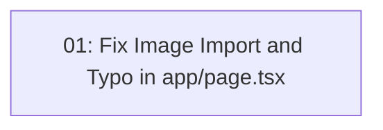

# Fix app/page.tsx Syntax and Import Errors

## Overview

Fix missing `next/image` import and `<Imag` typo in `app/page.tsx` that causes TypeScript compilation and ESLint validation failures.

## Quick Links

- [Requirements](./requirements.md) — full requirements and acceptance criteria
- [Action Required](./action-required.md) — manual steps needing human action
- [Investigation](./investigation.md) — root cause analysis and evidence

## Dependency Graph

## Batches

| Batch | Tasks | Description |
|------|-------|-------------|
| 1 | task-01 | Add `import Image from "next/image";` to line 1 and fix `<Imag` typo on line 48 |

## Task Status

### Batch 1
- [ ] [task-01-fix-image-import-and-typo](./tasks/task-01-fix-image-import-and-typo.md) — Fix Image import and typo in app/page.tsx

