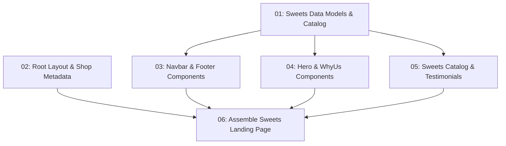

# Sweets Shop Landing Page

## Overview

A modern, inviting, and appetizing landing page for **"Sweet Delights"**, an artisanal sweets and confections store. The landing page replaces the default Next.js starter with a complete presentation layer consisting of brand navigation with announcement bar, hero section with trust badges and ordering CTAs, 4-pillar quality promise, signature sweets catalog cards with pricing and tags, customer testimonials, and a comprehensive footer with operating hours and contact details.

## Quick Links

- [Requirements](./requirements.md) — full requirements and acceptance criteria
- [Action Required](./action-required.md) — manual steps needing human action
- [Verification Report](./verification-report.md) — 10 of 11 criteria passed (offline build notice)

## Dependency Graph

## Batches

| Batch | Tasks | Description |
|------|-------|-------------|
| 1 | task-01, task-02 | Define TypeScript types, sweets catalog data (`lib/sweets-data.ts`), and update root layout metadata (`app/layout.tsx`) |
| 2 | task-03, task-04, task-05 | Create modular presentation components in parallel: Navbar/Footer, Hero/WhyUs, and SweetsGrid/Testimonials |
| 3 | task-06 | Assemble all components into `app/page.tsx` and verify the build |

## Task Status

### Batch 1
- [x] [task-01-sweets-data-and-types](./tasks/task-01-sweets-data-and-types.md) — Create Sweets Data Models and Catalog Data
- [x] [task-02-layout-and-branding](./tasks/task-02-layout-and-branding.md) — Update Root Layout and Shop Metadata

### Batch 2
- [x] [task-03-navbar-and-footer-components](./tasks/task-03-navbar-and-footer-components.md) — Create Navbar and Footer Components
- [x] [task-04-hero-and-features-components](./tasks/task-04-hero-and-features-components.md) — Create Hero and Why-Us Features Components
- [x] [task-05-sweets-catalog-and-reviews-components](./tasks/task-05-sweets-catalog-and-reviews-components.md) — Create Sweets Catalog Grid and Testimonials Components

### Batch 3
- [x] [task-06-assemble-sweets-page](./tasks/task-06-assemble-sweets-page.md) — Assemble Sweets Landing Page in app/page.tsx

## Verification

- Status: 10/11 criteria passed (see [verification-report.md](./verification-report.md))
- TypeScript & Lint: **PASS** (`npx tsc --noEmit` & `npm run lint` clean with 0 errors)
- Component Integration: **PASS**
- Production Build: **FAIL** (offline Google Font fetch notice)

